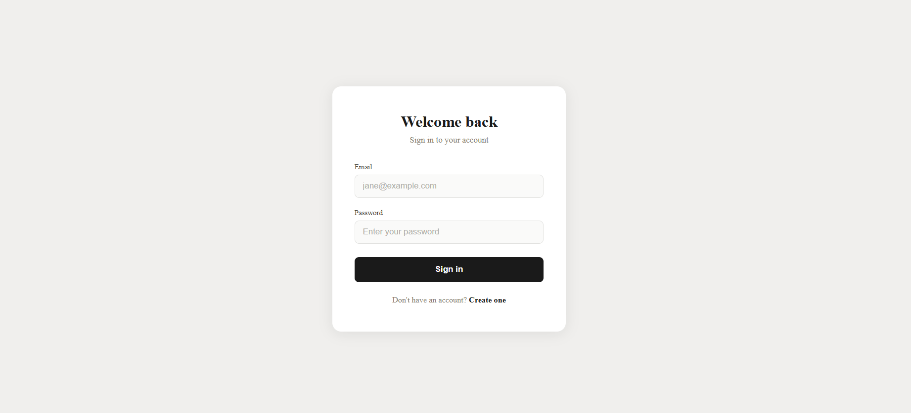
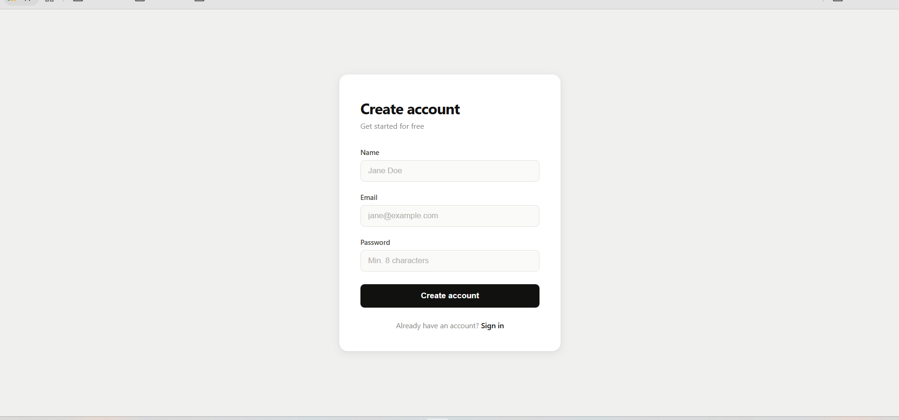
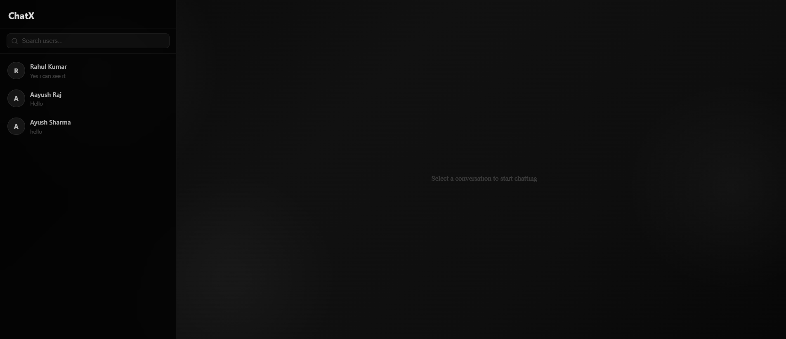
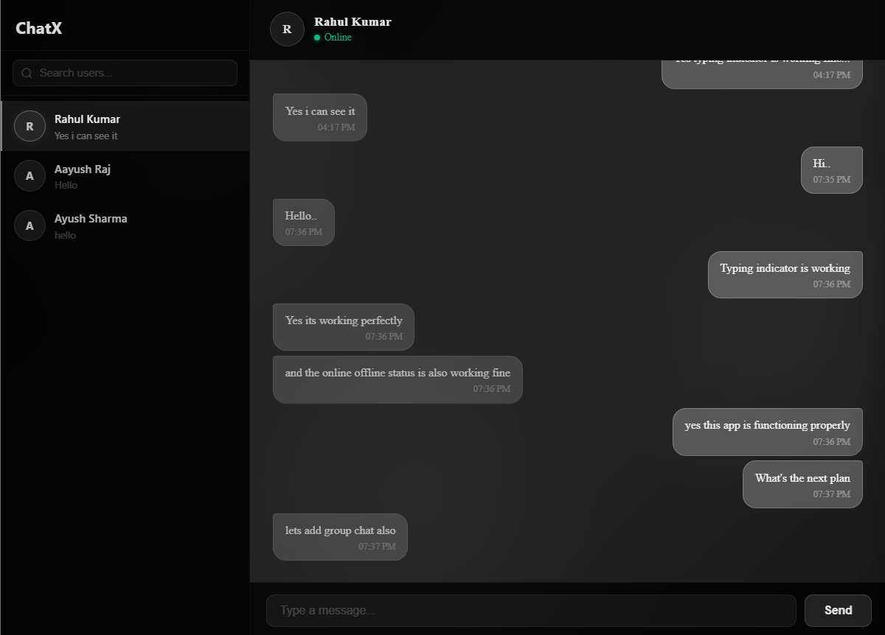
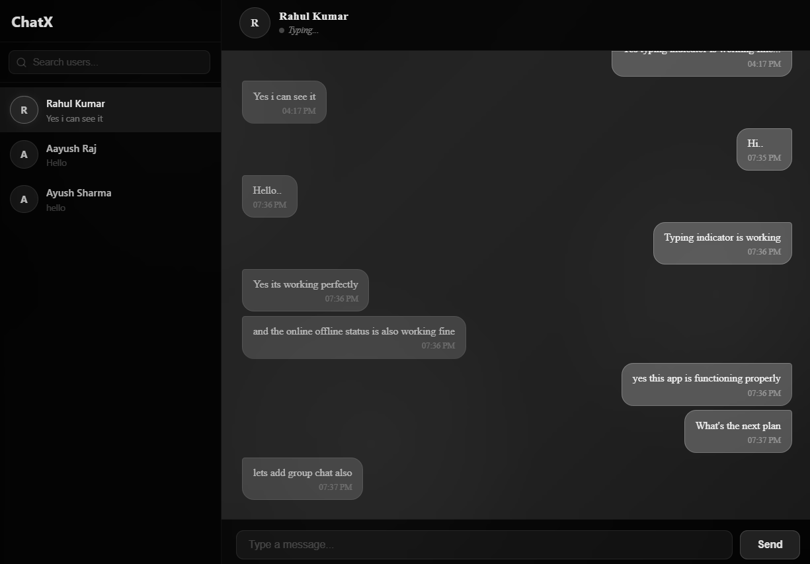

# 💬 ChatX — Full-Stack Real-Time Chat Application


🌐 **Live Demo:** *Coming Soon*

🎥 **Demo Video:** *Coming Soon*

---

ChatX is a full-stack real-time chat application built using the **MERN stack** and **Socket.IO**, enabling seamless one-to-one communication with low latency. The application provides secure authentication, instant messaging, online presence, typing indicators, and persistent chat history through a modern and responsive interface.

Designed with a scalable client-server architecture, ChatX leverages **React** for the frontend, **Node.js** and **Express.js** for the backend, **MongoDB** for persistent data storage, and **Socket.IO** for bidirectional real-time communication. The project follows a modular architecture to ensure maintainability, scalability, and clean code organization.

> 🚀 **Status:** Actively under development with new features and continuous improvements.

---

## 📑 Table of Contents

- ✨ Features
- 📸 Screenshots
- 🛠️ Tech Stack
- 🏗️ Architecture
- 📂 Folder Structure
- ⚙️ Installation
- 🔐 Environment Variables
- 🚀 Running the Application
- 📚 API Endpoints
- 🗄️ Database Schema
- 🎯 Future Enhancements
- 👨‍💻 Author

---

# ✨ Features

### 🔐 Authentication
- Secure user registration and login with JWT-based authentication.
- Passwords securely hashed using bcrypt.
- Protected API routes with token-based authorization.

### 💬 Real-Time Messaging
- Instant one-to-one messaging powered by Socket.IO.
- Real-time message delivery with low latency.
- Persistent message history stored securely in MongoDB.
- Automatic chat creation between users.

### 👥 User Experience
- Live typing indicators.
- Online and offline user presence.
- User search functionality.
- Responsive interface for desktop and mobile devices.
- Automatic scrolling to the latest messages.

### ⚡ Performance & Architecture
- Modular REST API architecture using Express.js.
- Real-time communication using Socket.IO rooms.
- MongoDB with Mongoose for efficient data modeling.
- Clean component-based React frontend.
- Scalable client-server architecture.

---

# 📸 Screenshots

Explore the core interface and real-time capabilities of **ChatX** through the following screenshots.

### 🔐 Login

<p align="center">
  
</p>

### 📝 Signup

<p align="center">
  
</p>

### 🏠 Home

<p align="center">
  
</p>

### 💬 Active Chat

<p align="center">
  
</p>

### ⌨️ Typing Indicator

<p align="center">
  
</p>

---

## 🛠️ Tech Stack

### Frontend
- **React.js** – Component-based user interface development
- **React Router** – Client-side routing and protected navigation
- **Axios** – HTTP client for API communication
- **Socket.IO Client** – Real-time bidirectional communication
- **CSS3** – Responsive and modern user interface styling

### Backend
- **Node.js** – JavaScript runtime environment
- **Express.js** – RESTful API development
- **Socket.IO** – Real-time event-based communication
- **JWT (JSON Web Token)** – Secure authentication and authorization
- **bcrypt** – Password hashing and security

### Database
- **MongoDB** – NoSQL database for storing users, chats, and messages
- **Mongoose** – Object Data Modeling (ODM) for MongoDB

### Development Tools
- **Git & GitHub** – Version control and source code management
- **VS Code** – Development environment
- **Postman** – API testing and debugging
- **MongoDB Atlas** – Cloud-hosted MongoDB database

---

## 🏗️ System Architecture

ChatX follows a client-server architecture where the React frontend communicates with the Express backend through REST APIs for authentication and data retrieval, while Socket.IO enables low-latency bidirectional communication for real-time messaging.

```text
                           +----------------------+
                           |    React Frontend    |
                           |----------------------|
                           |  React Router        |
                           |  Axios              |
                           |  Socket.IO Client   |
                           +----------+-----------+
                                      |
                     REST API / Socket.IO Connection
                                      |
                           +----------v-----------+
                           |   Express Backend    |
                           |----------------------|
                           |  Authentication      |
                           |  Chat APIs           |
                           |  Message APIs        |
                           |  Socket.IO Server    |
                           +----------+-----------+
                                      |
                                      |
                           +----------v-----------+
                           |      MongoDB         |
                           |----------------------|
                           | Users               |
                           | Chats               |
                           | Messages            |
                           +----------------------+
```

## 📂 Folder Structure

```text
ChatX/
│
├── backend/
│   ├── config/                 # Database configuration
│   ├── controllers/            # Business logic and request handlers
│   ├── middleware/             # Authentication & request middleware
│   ├── models/                 # Mongoose database models
│   ├── routes/                 # REST API routes
│   ├── sockets/
│   │   └── socket.js           # Socket.IO event handling
│   ├── utils/                  # Utility/helper functions
│   ├── .env                    # Environment variables
│   ├── index.js                # Backend entry point
│   ├── socket.js               # Socket.IO instance management
│   └── package.json
│
├── frontend/
│   ├── public/
│   ├── src/
│   │   ├── components/         # Reusable React components
│   │   ├── pages/              # Application pages
│   │   ├── services/           # API service layer
│   │   ├── assets/             # Static assets
│   │   ├── App.jsx
│   │   └── main.jsx
│   └── package.json
│
├── screenshots/                # README screenshots
├── .gitignore
└── README.md
```

---

## ⚙️ Installation

### 1️⃣ Clone the Repository

```bash
git clone https://github.com/raj-aayush01/ChatX.git
cd ChatX
```

---

### 2️⃣ Install Backend Dependencies

```bash
cd backend
npm install
```

---

### 3️⃣ Install Frontend Dependencies

```bash
cd ../frontend
npm install
```

---

### 4️⃣ Configure Environment Variables

Create a `.env` file inside the **backend** directory.

```env
PORT=3002
MONGO_URI=your_mongodb_connection_string
JWT_SECRET=your_jwt_secret
```

---

### 5️⃣ Start the Backend Server

```bash
cd backend
npm run dev
```

---

### 6️⃣ Start the Frontend

Open another terminal.

```bash
cd frontend
npm start
```

---

### 7️⃣ Open the Application

Visit:

```
http://localhost:3000
```

The application should now be running successfully.

---

## 🔐 Environment Variables

Create a `.env` file inside the `backend` directory and configure the following variables:

```env
PORT=3002
MONGO_URI=your_mongodb_connection_string
JWT_SECRET=your_jwt_secret
```

### Description

| Variable | Description |
|----------|-------------|
| `PORT` | Port on which the backend server will run. |
| `MONGO_URI` | MongoDB Atlas connection string used to connect to the database. |
| `JWT_SECRET` | Secret key used to generate and verify JSON Web Tokens. |

---

## 🚀 Running the Application

Start the backend server:

```bash
cd backend
node index.js
```

Open another terminal and start the frontend:

```bash
cd frontend
npm run dev
```

Once both servers are running, open your browser and visit:

```text
http://localhost:3000
```

The application should now be running locally with real-time messaging powered by Socket.IO.

---

## 📚 API Endpoints

### 🔐 Authentication

| Method | Endpoint | Description |
|---------|----------|-------------|
| `POST` | `/api/auth/signup` | Register a new user |
| `POST` | `/api/auth/login` | Authenticate an existing user |

---

### 👤 User

| Method | Endpoint | Description |
|---------|----------|-------------|
| `GET` | `/api/users/me` | Retrieve the authenticated user's profile |
| `GET` | `/api/users/search?search=` | Search users by name |

---

### 💬 Chats

| Method | Endpoint | Description |
|---------|----------|-------------|
| `GET` | `/api/chats` | Fetch all chats of the logged-in user |
| `POST` | `/api/chats` | Create or access a one-to-one chat |

---

### 📨 Messages

| Method | Endpoint | Description |
|---------|----------|-------------|
| `GET` | `/api/messages/:chatId` | Fetch all messages for a chat |
| `POST` | `/api/messages` | Send a new message |


> **Note:** All protected endpoints require a valid JWT token in the `Authorization` header.

Example:

```http
Authorization: Bearer <your_jwt_token>
```

---

## 📡 Socket.IO Events

ChatX uses **Socket.IO** to provide low-latency real-time communication between connected users.

| Event | Description |
|-------|-------------|
| `setup` | Initializes the socket connection for a user |
| `connected` | Confirms successful socket connection |
| `join chat` | Joins a specific chat room |
| `typing` | Broadcasts when a user starts typing |
| `stop typing` | Broadcasts when a user stops typing |
| `message received` | Delivers a newly received message in real time |
| `disconnect` | Handles user disconnection and updates online status |

---

## 🗄️ Database Schema

ChatX uses **MongoDB** with **Mongoose** to efficiently manage users, chats, and messages. The application is designed with three primary collections.

### 👤 User

| Field | Type | Description |
|-------|------|-------------|
| `_id` | ObjectId | Unique identifier for the user |
| `name` | String | User's display name |
| `email` | String | Unique email address |
| `password` | String | Hashed password |
| `profilePic` | String | User profile image |

---

### 💬 Chat

| Field | Type | Description |
|-------|------|-------------|
| `_id` | ObjectId | Unique chat identifier |
| `chatName` | String | Name of the chat |
| `isGroupChat` | Boolean | Indicates whether the chat is a group chat |
| `users` | Array<ObjectId> | Participants in the chat |
| `latestMessage` | ObjectId | Reference to the most recent message |
| `groupAdmin` | ObjectId | Administrator of the group (if applicable) |

---

### 📨 Message

| Field | Type | Description |
|-------|------|-------------|
| `_id` | ObjectId | Unique message identifier |
| `sender` | ObjectId | User who sent the message |
| `chat` | ObjectId | Associated chat |
| `content` | String | Message content |
| `createdAt` | Date | Timestamp of message creation |
| `updatedAt` | Date | Timestamp of last update |

---

## 🎯 Future Enhancements

The following features are planned for future releases:

- 👥 Group chat support
- 📁 Image and file sharing
- 😊 Emoji reactions
- ✏️ Edit and delete messages
- ✅ Message delivery and read receipts
- 🔔 Push notifications
- 📱 Progressive Web App (PWA) support
- 🌐 Application deployment
- 🎥 Voice and video calling
- 🔒 End-to-end encryption

---

## 👨‍💻 Author

**Aayush Raj**

- GitHub: https://github.com/raj-aayush01
- LinkedIn: https://www.linkedin.com/in/rajaayush01/
- Email: aayushraj065@gmail.com

If you found this project helpful, consider giving it a ⭐ on GitHub.
